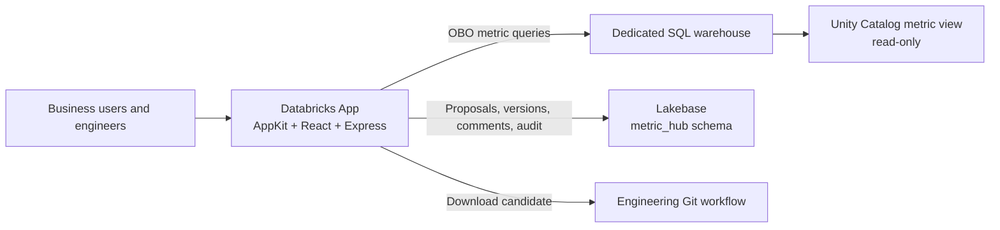

# Databricks Apps reference for FDEs

This repository is a reference for Forward Deployed Engineers building and adapting Databricks Apps. Metric View Collaboration Hub is its working example: a place for business stakeholders and engineers to discover governed metrics, discuss requested changes, review versions, and produce an engineering-ready SQL/YAML artifact.

Use the source and guides to understand how AppKit, user/OBO authorization, Unity Catalog metric views, a SQL warehouse, and Lakebase fit together. The domain data, roles, workflow, branding, and resource bindings are example choices to adapt for your own app. Sample Orders uses demonstration data that does not represent Servco business activity.

## Reference scope

The maintained operational guidance covers this Databricks App: prerequisites and project commands, app manifests, target/profile selection, resource bindings, identity and permissions, secret references, local proxy behavior, developer-schema isolation, deployment, readiness, and app start/stop controls.

General workstation preparation, local/remote development-environment certification, editor/agent integration setup, CI/CD, and broader DevOps tooling belong to a separate colleague-led project. Its name and link will be added when available. This repository does not maintain a general setup checker or installer. See the [scope and handoff notice](./dapps-env-setup.md) if you followed an older setup link.

## The problem

Metric views define important business KPIs, but business users should not need Unity Catalog write access or knowledge of metric-view SQL and YAML syntax to propose improvements. Engineers need enough structured context, acceptance criteria, history, and review evidence to implement those changes safely.

This app separates those responsibilities:

- Business users and reviewers work with guided forms and comments.
- Published Unity Catalog metric views remain read-only.
- Engineers receive a deterministic artifact for their normal Git review and deployment process.
- Application workflow data remains in an app-owned Lakebase schema.

## Current POC capabilities

- Browse live Auto Retail metrics from `hawaii_prod.testing.vw__metrics_test`.
- Select Sample Orders demonstration metrics, visibly identified as non-Servco data.
- Query governed data with the signed-in user's on-behalf-of authorization.
- Create structured proposals with dimensions, measures, business context, and acceptance criteria.
- Persist proposals, immutable versions, comments, and audit events in Lakebase.
- Move proposals through draft, review, approval, export, and publication-record states.
- Assign authenticated users to `reviewer` or `admin` application roles.
- Restrict proposal acceptance to configured admins in both the UI and server API.
- Download a deterministic SQL/YAML candidate without writing to Unity Catalog.

## Architecture



The deployed app uses these dedicated development resources:

| Resource           | Value                                  |
| ------------------ | -------------------------------------- |
| Databricks profile | `hawaii-dev-workspace`                 |
| App                | `metric-view-hub`                      |
| SQL warehouse      | `metric-view-hub-dev`                  |
| Lakebase project   | `projects/metric-view-hub`             |
| Metric view        | `hawaii_prod.testing.vw__metrics_test` |

## Security and governance

- Metric queries use OBO execution, so Unity Catalog applies the signed-in user's permissions.
- The app service principal owns the `metric_hub` Lakebase schema used for collaboration state.
- The app does not create, replace, or drop Unity Catalog metric views.
- Unlisted authenticated users default to `reviewer`.
- Emails configured in `APP_ADMIN_EMAILS` receive the `admin` role and can accept proposals.
- The server returns `403` for reviewer attempts to call the approval transition directly.

The email allowlist is suitable for this small POC. A later production design can resolve roles from Databricks groups instead.

## Configure the reference app

Start with an already prepared workstation with Node.js 22+, npm, a modern Databricks CLI 1.0.0+, and an authenticated profile for the intended workspace. Required permissions and resource values are specific to the app; installed tools alone do not prove access.

For agent-guided app configuration, prompt: **“Read `init.md` and configure the reference app for local development.”** The root [`init.md`](./init.md) leads through explicit profile selection, locked app dependencies, existing `.env` preservation, resource configuration, and the full-stack local proxy. It does not install or certify your general workstation.

Per-FDE isolation uses the local app process and a unique developer Lakebase schema. The deployed development app
is a shared integration instance, while the BA app is a separate shared environment; neither is deployed per FDE.
Operating either shared app requires separate approval and its explicit environment target/profile.

## Start and stop the deployed POC

The app is deliberately stopped outside development sessions and demos to avoid continuous app-compute charges.

```sh
# Start the last successful deployment.
databricks apps start metric-view-hub --profile hawaii-dev-workspace

# Confirm that app_status is RUNNING and compute_status is ACTIVE.
databricks apps get metric-view-hub --profile hawaii-dev-workspace -o json

# Stop app compute when the session ends.
databricks apps stop metric-view-hub --profile hawaii-dev-workspace
```

App URL: <https://metric-view-hub-4192082222593323.3.azure.databricksapps.com>

Starting the app restores its last successful deployment and existing Lakebase data. It does not require a new deployment.

## Run the full application locally

The client and API support a local hot-reload loop backed by an isolated developer schema in the existing development Lakebase project:

```sh
cd metric-view-hub
databricks apps run-local --entry-point app.local.yaml --profile hawaii-dev-workspace --env METRIC_HUB_SCHEMA=metric_hub_local_roberto --env LOCAL_DEV_EMAIL=roberto.delgado@servco.com
```

Open <http://localhost:8001>. See [`metric-view-hub/README.md`](./metric-view-hub/README.md) for the one-time `.env` setup, identity behavior, and local-versus-deployed data boundary.

## Validate the application locally

From `metric-view-hub`:

```sh
npm ci
npm run typegen -- --wait
npm run format
npm run lint
npm run typecheck
npm test
npm run build
databricks apps validate --profile hawaii-dev-workspace
```

## Repository planning

This repository uses Reffy and ReffySpec to record ideation, reviewed changes, and current requirements. They are maintainer planning tools, not prerequisites for developing or deploying the Databricks App and not an organization-wide framework mandate.

Repository planning tools use pnpm independently of the npm-managed application in `metric-view-hub/`. From the repository root:

```sh
pnpm install --frozen-lockfile
pnpm exec reffy init
pnpm exec reffy doctor
pnpm exec reffy validate
```

Start with [`AGENTS.md`](./AGENTS.md) and the populated [project context](./.reffy/reffyspec/project.md). Reffy maintains ideation artifacts, current specs, and proposed changes under `.reffy/`. The existing seed, proposal, and playbook remain source documents; they have not been automatically converted into canonical specs.

## Repository guide

| Path                                                               | Purpose                                                                               |
| ------------------------------------------------------------------ | ------------------------------------------------------------------------------------- |
| [`seed-1.md`](./seed-1.md)                                         | Original business problem and product seed                                            |
| [`seed-1-proposal.md`](./seed-1-proposal.md)                       | Architecture, governance, delivery phases, and acceptance criteria                    |
| [`metric-view-hub/`](./metric-view-hub/)                           | AppKit application source and deployment configuration                                |
| [`metric-view-hub/README.md`](./metric-view-hub/README.md)         | Application-specific development and resource details                                 |
| [`init.md`](./init.md)                                             | App-specific configuration and local-start entry point                                |
| [`dapps-env-setup.md`](./dapps-env-setup.md)                       | Reference scope and external DevOps ownership handoff                                 |
| [`reference-app-poc-playbook.md`](./reference-app-poc-playbook.md) | Living record of prompts, decisions, failures, corrections, and verification evidence |

## Next steps

- Verify the reviewer experience with an authenticated user who is not on the admin allowlist.
- Resolve roles from Databricks groups instead of a static email list.
- Add editable revisions after changes are requested.
- Connect accepted artifacts to a pull-request workflow.
- Add graceful shutdown handling for the AppKit Lakebase pools.
